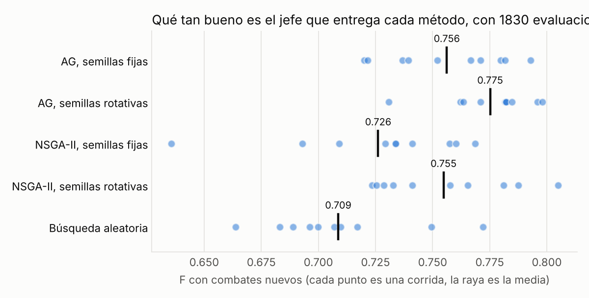

# Jefe RPG evolutivo

Dos algoritmos evolutivos que diseñan jefes para un RPG por turnos: un algoritmo genético binario de un solo objetivo y NSGA-II, su versión multiobjetivo. Un motor de combate enfrenta a cada jefe contra los 15 equipos que puede armar el jugador, y los algoritmos buscan el jefe que da el combate más parejo: que el equipo gane entre 40% y 60% de las veces, en unas 14 rondas, y termine con poca vida.

Proyecto final de Cómputo Evolutivo, CETYS Universidad.

## Requisitos

- Python 3.10 o más reciente
- pytest, matplotlib y pygame

## Instalación

Windows (PowerShell):

```powershell
git clone <url-del-repositorio>
cd <carpeta-del-repositorio>
python -m venv .venv
.\.venv\Scripts\Activate.ps1
pip install -r requirements.txt
```

macOS o Linux:

```bash
git clone <url-del-repositorio>
cd <carpeta-del-repositorio>
python3 -m venv .venv
source .venv/bin/activate
pip install -r requirements.txt
```

## Cómo probarlo

Los comandos van en la terminal. Todo usa semillas fijas, así que los números deben coincidir con los de esta tabla.

| Paso | Comando | Qué debe salir | Tiempo |
|---|---|---|---|
| 1 | `python -m pytest -q` | 96 passed | 50 s |
| 2 | `python genetico.py` | Termina con F = 0.8110 | 60 s |
| 3 | `python nsga2.py` | Un frente de 7 jefes con hipervolumen 0.4268 | 60 s |
| 4 | `python narrar.py resumen` | Un combate, una línea por ronda | 1 s |
| 5 | `python jugar.py` | Eliges un jefe del frente y juegas contra él en la terminal | lo que dure la partida |
| | `python juego.py` | El juego con ventana, música y sonido | lo que dure la partida |
| | `python entrenamiento.py` | Entrena al jefe del juego y lo guarda en jefe_optimo.json | 2 min |
| 6 | `python comparar.py corto` | resultados_corto.csv y comparacion_corto.png | 12 min |
| 7 | `python comparar.py` | resultados_largo.csv, comparacion_largo.png y frente.png | 40 min |

Los tiempos son de una máquina con 2 núcleos; `comparar.py` reparte las corridas entre todos los que haya.

Si el paso 1 falla, no sigas: algo está roto.

## El juego

Cuatro héroes contra un jefe, por turnos. El jugador arma su equipo con 4 de las 6 clases.

Todos los personajes tienen seis atributos: vida, ataque físico, defensa física, ataque mágico, defensa mágica y velocidad. Cada clase reparte 600 puntos entre ellos; el maná va aparte.

| Clase | Perfil | Conjuros |
|---|---|---|
| Guerrero | Equilibrado en todo | Guardia de acero (sube su defensa dos turnos) y dos tajos mágicos de elemento aleatorio |
| Tanque | Mucha vida y defensa, poco ataque y velocidad. Provoca: el jefe lo ataca 3.5 veces más seguido que a los demás | Muralla (sube su defensa dos turnos) y Bloqueo total (anula un ataque) |
| Mago | Mucho ataque mágico, poca vida y defensa | 3 conjuros de una lista de 16 y 1 de una lista de 8 poderosos, sin repetir elemento |
| Clérigo | Equilibrado, su magia cura | Curación menor, mayor y en grupo |
| Pícaro | Ataque físico y velocidad altos, defensa baja | Dos ataques que se adelantan a todos en la ronda |
| Berserker | Mucho ataque físico, poca defensa mágica | Furia (sube su ataque dos turnos) y Furia desatada (sube su ataque y pega) |

Reglas principales:

- **Ataques físicos y mágicos.** Los físicos usan ataque y defensa físicos, varían entre x0.80 y x1.20 y pueden salir críticos (x1.60). Guerrero y Pícaro tienen más probabilidad de crítico y su mínimo es x0.90. Los mágicos usan los atributos mágicos, varían entre x0.85 y x1.00, no tienen crítico y llevan un elemento.
- **Elementos y objetos.** Hay 8 elementos: fuego, agua, viento, tierra, planta, rayo, luz y oscuridad. Un elemento es solo una etiqueta: lo que importa son los objetos equipados, que dan bonos como +20% de ataque de fuego o -25% de defensa contra agua. Hay 16 objetos, dos por elemento.
- **Velocidad.** Decide el orden de los turnos. Quien es más rápido que su atacante puede esquivar: la probabilidad crece con la diferencia de velocidad, de 1% a 15%.
- **Maná.** Todos los conjuros cuestan maná y el ataque básico es gratis. Todos recuperan un poco cada turno: Mago y Clérigo lo suficiente para vivir de su magia, las demás clases como la energía de un guerrero, para usar una técnica cada dos o tres turnos.
- **Rondas.** Al empezar cada ronda los cuatro héroes eligen qué van a hacer, con lo que se sabe en ese momento, y luego se resuelve todo: primero los ataques que se adelantan y después todos por velocidad, el jefe incluido. Nadie puede esperar a ver a quién le pega el jefe para decidir. Si el aliado al que iba una cura o una poción cae antes, se la lleva el aliado vivo más herido.
- **Bloquear.** Cualquiera puede gastar su turno en bloquear y recibir la mitad del daño hasta su siguiente turno.
- **Pociones.** El equipo comparte tres pociones chicas y dos grandes de vida, y dos chicas y una grande de maná. Cualquier héroe puede tomarla o dársela a un aliado; la que alguien aparta al elegir ya no la puede escoger otro en esa ronda, y si quien la apartó cae antes de usarla vuelve a quedar libre. No hay forma de revivir.

El jefe reparte 1500 puntos entre sus seis atributos y lleva un objeto. No gasta maná y sus críticos son menos probables.

- **Cola de ataques.** Tiene 8 ataques tomados de un banco de 32, en fila. Solo puede elegir entre los primeros 4; el que usa pasa al final de la fila.
- **Ataques de área y de carga.** Los de área pegan a todos, cada uno un poco menos que un golpe normal, y cuentan solo 0.3 en la ruleta con la que elige su ataque, así que salen poco pero cuando salen se sienten. Cuatro ataques del banco gastan un turno en cargar y pegan muy fuerte al siguiente, lo que le da tiempo al equipo de bloquear.
- **Fase 2.** En cuanto baja de la mitad de su vida se transforma y la ronda se corta ahí: lo que faltaba por hacer ya no pasa y empieza una ronda nueva en la que todos vuelven a elegir. Cambia de objeto, dos ataques de su cola se reemplazan por otros y sus atributos se mueven un poco hacia arriba o hacia abajo.
- **Predisposición.** Elige a quién atacar con una probabilidad por clase que viene en sus genes: la clase que más prefiere sale a lo mucho 4.5 veces más que la que menos (antes eran 8).
- **No bloquea.** Hasta la etapa 6 el jefe podía gastar turnos en cubrirse, y los algoritmos aprendían a usarlo para alargar los combates y dejar al equipo justo con la vida que premia F en lugar de lograrlo con sus ataques. Desde la etapa 7 siempre ataca o carga.

**Calibración de clases.** Los puntos de cada clase y el poder de sus conjuros están ajustados para que los 15 equipos tengan una fuerza parecida. Con la primera versión de las clases, contra jefes aleatorios de dificultad intermedia, la tasa de victoria iba de 21% con el equipo más débil a 84% con el más fuerte; después del ajuste va de 44% a 53%. El ajuste se hizo contra jefes aleatorios, no contra los que entregan los algoritmos: se midió cuánto cambia la tasa de victoria de un equipo por llevar cada clase y se corrigió hasta dejar ese efecto cerca de cero.

| Clase | Efecto antes | Efecto después | Qué se ajustó |
|---|---|---|---|
| Guerrero | −0.17 | −0.02 | Tajos más fuertes (1.8 y 2.6) y más maná (66) |
| Tanque | −0.22 | 0.00 | Provocación y algo de vida y defensa mágica pasadas a ataque |
| Mago | +0.19 | +0.02 | Conjuros con 30% menos poder |
| Clérigo | −0.10 | −0.03 | Curas 25% más fuertes y algo de defensa pasada a ataque |
| Pícaro | +0.16 | +0.01 | Menos ataque y más vida; sus ataques que se adelantan pegan menos |
| Berserker | +0.15 | +0.02 | Menos ataque y más defensa mágica; Furia sube el ataque x1.3 en lugar de x1.5 |

El efecto es la tasa de victoria media de los equipos que llevan la clase menos la de los que no. `python calibrar.py` lo vuelve a medir.

En la etapa 7, al pasar a rondas planeadas y a un objetivo de 14 rondas, se recalibró todo para que el equipo dependa más de curarse y cada clase juegue su papel: la vida de los héroes se multiplicó por 1.27 (el Mago pasa de 210 a 266), las curas del Clérigo son 25% más fuertes, hay dos pociones de vida más, todas las clases recuperan algo de maná y el jefe ya no bloquea. El jefe recibe 5.5 de vida por punto en lugar de 3.3 y su ataque se escala x1.54 en lugar de x1.8. Contra 60 jefes aleatorios el equipo se cura 69% de su vida total por combate, contra 37% con las reglas de antes, y los ataques de área bajaron de 36% a 25% de los golpes del jefe. Con 500 jefes aleatorios la mediana de duración quedó en 14.5 rondas, la tasa de victoria entre equipos va de 43% a 55% y ninguna clase mueve la tasa de victoria más de 0.04.

Al equipo lo controla un jugador automático durante la evaluación (`heuristico.py`). Cada clase juega su papel como lo haría una persona en un RPG por turnos: el Clérigo cura en cuanto alguien baja de 80% y solo pega cuando todos están casi llenos; el Mago vive de su magia, repone maná antes de quedarse sin conjuros y guarda el poderoso para cuando el jefe es débil a ese elemento o ya está en su segunda fase; el Tanque mantiene su defensa arriba; Guerrero, Pícaro y Berserker usan sus técnicas siempre que les alcanza el maná. Todos toman poción si están por caer, le pasan una al aliado que lo está si ellos van bien y se cubren cuando el jefe carga un golpe fuerte. En combates contra jefes aleatorios el Clérigo cura en dos de cada tres turnos, el Mago lanza magia en 86% de los suyos y el Guerrero usa sus tajos en casi la mitad. En `jugar.py` lo controlas tú, con las mismas reglas, y puedes escoger entre el jefe que eligió el algoritmo y el mejor del frente en cada objetivo.

## Juego con ventana

`python juego.py` abre el juego con pygame, con música y efectos de sonido. Se maneja con las flechas y Enter (o Z) para elegir, Escape (o X) para regresar, o con el ratón. F11 cambia a pantalla completa.

**Título.** Cuatro opciones: Jugar, Entrenar jefe, Opciones y Salir. Al fondo está el retrato del jefe con la rueda sobre su cabeza, que gira de punta en punta y se frena en seco.

**Entrenar jefe.** Corre NSGA-II con el presupuesto completo del experimento: 30 jefes, 30 generaciones con semillas rotativas, unas 1,830 evaluaciones de 150 combates cada una. Corre en un proceso aparte, así que la ventana sigue respondiendo y muestra en vivo el hipervolumen de cada generación, la población sobre dos de sus objetivos y una bitácora. Al terminar toma los cinco mejores del frente según el criterio de `nsga2.py`, vuelve a medir a cada uno con 30 combates nuevos por equipo (los objetivos del frente traen mucho ruido), se queda con el que mejor sale, lo valida con otros 30 combates por equipo y lo guarda en `jefe_optimo.json`. El jefe marcado en `frente.json` se escoge igual. En una máquina de 2 núcleos tarda unos dos minutos y medio; con la semilla 11 el jefe quedó con F = 0.750 validada, el equipo le gana el 44 % de las veces y los combates duran 14.3 rondas en promedio. Cada entrenamiento usa una semilla distinta, así que el jefe cambia de una vez a otra. También se puede correr sin ventana con `python entrenamiento.py`.

**Jugar.** Ya no hay que elegir jefe: se juega contra el último que se entrenó, y si todavía no hay ninguno, contra el que eligió NSGA-II en la corrida guardada en `frente.json`. A ese jefe se le sumaron a mano 100 de vida después de elegirlo (el campo `vidaExtra` de `frente.json` y `mejor_jefe.json`, que la búsqueda nunca toca), para que la pelea dure un poco más; pasa de 946 a 1046. Los números de este README sobre el jefe del juego son de antes de sumársela. La pantalla de equipo muestra las seis clases con sus atributos, conjuros y objeto; se eligen cuatro y abajo aparecen el equipo y la ficha del jefe.

**Combate.** El motor corre en un hilo aparte y se detiene cada vez que le toca decidir al jugador, así que las reglas y los números son los de la evaluación; hay una prueba que lo comprueba combate contra combate. Al empezar cada ronda se eligen las acciones de los cuatro héroes, uno tras otro, y sobre los que ya eligieron queda escrito lo que van a hacer; luego corre la ronda completa. El menú va por categorías (Ataque, Magia, Bloqueo y Objetos) con una mano que señala la opción y una flecha junto al héroe que está eligiendo. Las curas individuales y las pociones piden además a quién van, con la mano sobre ese aliado. Mientras corre la ronda, el menú se cambia por un cuadro de diálogo que cuenta lo que pasa. Escape abre la pausa, con el volumen de la música y de los efectos.

Todos los héroes menos el mago pegan cuerpo a cuerpo, también con sus conjuros de ataque: corren hasta enfrente del jefe, pegan y regresan. El mago lanza su magia desde su lugar y el clérigo cura sin moverse. El jefe se lanza hasta el centro de la arena en sus golpes físicos a un solo héroe. Lo que reduce el daño que recibe un héroe se ve como un escudo sobre su cabeza, que se va justo cuando se acaba el efecto, porque el motor anota en cada turno qué protecciones siguen activas. Las barras de vida dejan ver en blanco lo que se acaba de perder, y la vida de un héroe se pone amarilla y luego roja cuando baja.

**Animaciones de ataque.** Cada ataque tiene su propia animación, armada por código en `grafico/recetas.py` sobre el motor de `grafico/animaciones.py`: partículas, relámpagos, tajos, anillos de choque, destellos de pantalla y sacudidas, como en los RPG de 16 bits. Se dibujan en capas a la mitad de la resolución y se agrandan al doble sin suavizar, para que tengan el mismo grueso de pixel que el resto del arte. Los ataques que se usan poco y pegan fuerte son los más vistosos: los cuatro que el jefe carga un turno antes (Cataclismo es una lluvia de meteoros, Rayo final un haz que cruza la pantalla, Devastación revienta el piso hasta cada héroe y Aplastamiento deja caer una espada gigante) y los ocho conjuros poderosos del mago, uno por elemento. El turno dura lo que dure su animación, las vidas cambian en el instante del impacto y quien recibe el golpe parpadea en blanco. `python -m grafico.galeria` muestra cualquier animación suelta.

**Segunda fase.** Cuando el jefe baja a la mitad de su vida empieza a sacudirse, la arena retumba y caen rayos. Un destello corta a su retrato: la rueda gira de punta en punta y se frena en seco en cada una, cada vez con menos pausa y más rápido, y cada frenón sacude la pantalla más fuerte. Cuando ya no se detiene, abre la boca y grita mientras salen rayos de la rueda y todo retiembla. Otro destello y de vuelta en la arena, que ya es la de la segunda fase, con el jefe transformado y su propia música. Cualquier tecla salta la cinemática.

**Final y resultados.** Si el jefe cae, tiembla mientras estalla, se pone blanco y se deshace en luz; los héroes celebran y suena la fanfarria. Si cae el equipo, el jefe se ríe. La pantalla de resultados muestra al equipo, lo que hizo cada héroe (daño, daño recibido, curación, críticos y esquivas), al más valioso, y cómo califica el algoritmo ese combate: el margen, la duración y la variedad, con las mismas fórmulas de `aptitud.py`, y la nota que les darían los pesos de F.

**Arte.** Los héroes salen de sus hojas de diseño en `recursos/disenos/` (`python -m grafico.extraerSprites`) y el jefe de sus dos ilustraciones (`python -m grafico.extraerJefe`); `python -m grafico.poses` genera sus poses moviendo pixeles completos, y `python -m grafico.generarEfectos` dibuja el icono de cada ataque. Las arenas, el retrato del título y su rueda están en `recursos/escenarios/`.

**Música y sonido.** Todo está compuesto en `grafico/generarAudio.py` y `grafico/componerMusica.py`; `python -m grafico.generarAudio` lo vuelve a generar. Hay siete temas. Los dos combates y la pantalla de equipo van con instrumentos: la partitura se escribe como MIDI y la toca FluidSynth con el banco libre FluidR3_GM. Los combates siguen la forma de los temas de jefe final de los RPG, sin copiar ninguno: el leitmotiv del jefe es la melodía del título pasada a menor armónica, empieza oscuro con órgano, timbales y coro, sigue con un ostinato de cuerdas con acentos 3+3+2, metales y batería de rock, y en la segunda fase vuelve tres semitonos más arriba, más rápido y con coro en acordes cortados (en Ubuntu se instalan con `apt install fluidsynth fluid-soundfont-gm`; sin ellos salen con ondas puras). El título, la victoria, la derrota y el entrenamiento son de ondas cuadradas, triángulo y ruido, al estilo de las consolas de 8 bits. Hay además más de sesenta efectos y voces sintetizadas: gritos de cada clase al atacar, quejidos y los rugidos, la risa y el grito del jefe. Si hay ffmpeg se guardan en ogg y si no en wav. El volumen se recuerda en `opciones.json`.

## Archivos

| Archivo | Qué hace |
|---|---|
| `motor.py` | Fachada: junta los módulos de abajo para que los scripts usen `import motor` |
| `reglas.py` | Elementos, objetos y fórmulas de daño |
| `clases.py` | Las seis clases, sus conjuros y los 15 equipos |
| `jefe.py` | Puntos del jefe, banco de 32 ataques, fase 2 y reparación del cromosoma |
| `heuristico.py` | Jugador automático |
| `combate.py` | Simulación de un combate |
| `aptitud.py` | Función objetivo F y función de costo C = 1 − F |
| `genetico.py` | Algoritmo genético binario (rango, costo o torneo; cruce de un punto; mutación; elitismo) y búsqueda aleatoria |
| `nsga2.py` | NSGA-II: ordenamiento no dominado, distancia de crowding, torneo binario, restricción e hipervolumen |
| `comparar.py` | Experimento final: los dos algoritmos, con semillas fijas y rotativas, contra la búsqueda aleatoria |
| `narrar.py` | Cuenta un combate turno por turno |
| `jugar.py` | Modo interactivo en la terminal, contra un jefe del frente |
| `juego.py` | Juego con ventana: título, entrenamiento, equipo, combate y resultados |
| `entrenamiento.py` | Entrena al jefe del juego con NSGA-II y lo guarda en `jefe_optimo.json` |
| `grafico/` | Lo que usa `juego.py`: `interfaz.py` (ventanas, botones y cursor), `escenas.py` (equipo y combate), `pantallas.py` (título, opciones, entrenamiento, pausa y resultados), `cinematica.py` (la segunda fase), animaciones de ataque (`animaciones.py` es el motor y `recetas.py` la de cada ataque), números flotantes, carga de recursos y el puente con el motor; `galeria.py` para ver las animaciones sueltas; además `extraerSprites.py`, `extraerJefe.py`, `poses.py`, `generarEfectos.py` y `generarAudio.py`, que generan el arte y el sonido |
| `recursos/` | Arte, música y sonido; `recursos/disenos/` guarda los diseños originales y `recursos/LEEME.md` lista todos los archivos que el juego busca |
| `calibrar.py` | Jefes aleatorios: histograma de la tasa de victoria y efecto de cada clase sobre su equipo |
| `test_motor.py`, `test_genetico.py`, `test_nsga2.py`, `test_grafico.py` | Pruebas con los valores esperados calculados a mano |
| `frente.json`, `mejor_jefe.json` | El frente de una corrida de NSGA-II y el jefe elegido de ese frente; si los borras, se vuelven a crear |

## Cromosoma

132 bits (hasta la etapa 6 eran 134, con 2 bits más para la probabilidad de que el jefe bloqueara):

| Tramo | Bits | Qué guarda |
|---|---|---|
| 6 atributos | 6 × 4 | Proporción del presupuesto de 1500 puntos |
| 2 objetos | 2 × 4 | Objeto de la fase 1 y de la fase 2 |
| 8 ataques | 8 × 5 | La cola inicial, con índices del banco de 32 |
| 8 pesos | 8 × 2 | Qué tanto prefiere cada ataque de la cola |
| 2 cambios de fase 2 | 2 × (3 + 5) | Qué posición de la cola cambia y por cuál ataque |
| 5 ajustes de fase 2 | 5 × 2 | Cómo se mueve cada atributo, menos la vida |
| 6 predisposiciones | 6 × 3 | Preferencia por atacar a cada clase |

Una función de reparación hace válida cualquier cadena de bits: los puntos suman 1500, no hay ataques repetidos en la cola y los ataques que entran en la fase 2 no repiten a los que ya están.

## Función objetivo y función de costo

```
F = f_win × (0.5·margen + 0.25·duración + 0.25·variedad)
C = 1 − F        (el algoritmo minimiza C)
```

- `f_win = 1 − 2d`, con d = distancia de la tasa de victoria del equipo a la banda 40–60%
- margen: qué tan cerca de 20% de vida termina el equipo cuando gana
- duración: qué tan cerca de 14 rondas dura el combate (una campana con desviación de 3 rondas)
- variedad: entropía de Shannon del uso de las habilidades del jefe, entre su máximo

Cada jefe pelea 10 combates contra cada uno de los 15 equipos (150 en total) y su F es el promedio de los 15.

## NSGA-II

F junta tres medidas en un solo número con pesos que escogimos a mano. NSGA-II trabaja con las medidas por separado y entrega un frente de Pareto: un conjunto de jefes donde ninguno es mejor que otro en todo.

Objetivos, los tres a minimizar:

| Objetivo | Qué mide |
|---|---|
| Desbalance | Qué tan lejos queda la tasa de victoria de cada equipo de 50% |
| Holgura | El equipo gana con mucha más vida que el 20% ideal (1 − margen) |
| Desajuste de duración | Los combates duran mucho más o mucho menos de 14 rondas (1 − duración) |

La variedad no entra como objetivo. Desde que el jefe ataca con una cola, casi cualquier jefe la tiene arriba de 0.9, y como objetivo solo llenaba el frente de jefes malos que ganaban una centésima de variedad.

Restricción: un jefe solo es aceptable si, en promedio, la tasa de victoria de los equipos queda a no más de 0.10 de la banda 40–60%. Se usa dominancia con restricciones: el que cumple le gana al que no, y entre dos que no cumplen gana el que viola menos. Sin la restricción el frente se llenaba de jefes con la duración perfecta que ningún equipo podía vencer.

El cromosoma, el cruce de un punto y la mutación son los mismos del algoritmo genético. Cambia la selección: ordenamiento no dominado, distancia de crowding y torneo binario, y los sobrevivientes se escogen entre padres e hijos juntos.

**Semillas rotativas.** Para atacar el sobreajuste, cada generación pelea combates distintos y los padres se vuelven a evaluar junto con sus hijos. Cuesta el doble de evaluaciones por generación. El algoritmo genético de un solo objetivo también lo puede usar, con `rotarSemillas=True`.

## Resultados

10 corridas por método. Al final de cada corrida, el jefe que entrega el método se vuelve a medir con 30 combates por equipo que ningún método vio durante la búsqueda. Esa es la columna que cuenta.

Presupuesto largo, 1830 evaluaciones (60 generaciones de 30 jefes):

| Método | F en la búsqueda | F con combates nuevos | t contra aleatoria | Corridas arriba de la media aleatoria |
|---|---|---|---|---|
| AG, semillas rotativas | 0.777 | 0.775 ± 0.020 | 5.64 | 10 de 10 |
| AG, semillas fijas | 0.826 | 0.756 ± 0.026 | 3.67 | 10 de 10 |
| NSGA-II, semillas rotativas | | 0.755 ± 0.029 | 3.39 | 10 de 10 |
| NSGA-II, semillas fijas | | 0.726 ± 0.039 | 1.09 | 8 de 10 |
| Búsqueda aleatoria | 0.750 | 0.709 ± 0.032 | | |



Presupuesto corto, 630 evaluaciones (el del avance 2):

| Método | F en la búsqueda | F con combates nuevos | t contra aleatoria |
|---|---|---|---|
| AG, semillas rotativas | 0.753 | 0.768 ± 0.022 | 3.90 |
| AG, semillas fijas | 0.789 | 0.733 ± 0.026 | 1.10 |
| NSGA-II, semillas rotativas | | 0.729 ± 0.042 | 0.62 |
| NSGA-II, semillas fijas | | 0.720 ± 0.047 | 0.11 |
| Búsqueda aleatoria | 0.727 | 0.718 ± 0.034 | |

Lo que dicen los números (con las reglas de la etapa 7):

- **El algoritmo genético con semillas rotativas entrega los mejores jefes con los dos presupuestos** (0.768 y 0.775) y es el que más se separa de la búsqueda aleatoria: t de 3.9 y 5.6, y sus 10 corridas quedan arriba de la media aleatoria en ambos.
- **Con el presupuesto largo los algoritmos le sacan más ventaja a la búsqueda aleatoria que en la etapa 6:** los tres mejores métodos quedan entre 4.6 y 6.6 centésimas arriba, contra 2.6 a 5.3 entonces. Probablemente porque, con cada clase jugando su papel, un jefe al azar es parejo contra menos equipos (la búsqueda aleatoria bajó de 0.754 a 0.709) y buscar sirve más.
- **Las semillas rotativas siguen siendo lo que más ayuda.** El algoritmo genético con semillas fijas llega a 0.826 durante la búsqueda y baja a 0.756 con combates nuevos; NSGA-II con semillas fijas apenas se separa de la búsqueda aleatoria y con semillas rotativas sube a 0.755.
- **NSGA-II perdió la ventaja que tenía en la etapa 6** y queda empatado con el algoritmo genético de semillas fijas. Lo más probable es el ruido: los combates tienen más azar, los tres objetivos que mide con 10 combates por equipo traen más ruido y escoger del frente con ellos es menos confiable. Por eso el jefe del juego se escoge volviendo a medir a los cinco mejores del frente. Sigue entregando un frente de jefes para escoger.
- **El objetivo de 14 rondas es el más difícil de cumplir:** el jefe del juego saca 0.63 en duración, el más bajo de los cuatro términos de F.


Limitaciones:

- Con 10 combates por equipo la tasa de victoria de cada equipo se mide con mucho ruido, y los objetivos del frente también: al volver a medirlos con combates nuevos algunos jefes del frente quedan dominados por otros.
- 10 corridas por método es poco para afirmar diferencias chicas, como la que hay entre NSGA-II y el algoritmo genético con semillas rotativas.
- El término de duración sigue siendo el más bajo de F: contra el jefe elegido los equipos tardan en promedio entre 9 y 18 rondas, según cuál sea.
- El jugador automático no planea a futuro. Un jefe parejo contra él no tiene por qué serlo contra una persona, y la calibración de clases también se hizo contra él.

## Cómo se llegó aquí

El proyecto pasó del juego del avance 2 al actual en siete etapas. Cada una deja el repositorio funcionando, con sus pruebas pasando y sus propios resultados.

| Etapa | Qué cambió | Cromosoma | Pruebas | F del AG por rango, 630 evaluaciones (búsqueda / combates nuevos) |
|---|---|---|---|---|
| Avance 2 | Punto de partida: 4 héroes, 4 elementos en ciclo, jefe de 4 habilidades | 44 bits | 33 | 0.886 / 0.687 |
| 1 | Se separa `motor.py` en módulos, sin cambiar ninguna regla | 44 bits | 33 | 0.886 / 0.687 |
| 2 | Lado de los héroes: 6 atributos, 6 clases con conjuros y maná, 8 elementos con objetos, físico y mágico, críticos, esquive, bloqueo, pociones de maná, 15 equipos | 56 bits | 43 | 0.586 / 0.471 |
| 3 | Lado del jefe: cola de 8 ataques de un banco de 32, ataques de carga, fase 2 completa, predisposición por clase | 134 bits | 50 | 0.751 / 0.606 |
| 4 | NSGA-II con restricción, hipervolumen y semillas rotativas | 134 bits | 63 | |
| 5 | Experimento final con validación y dos presupuestos; el juego usa el frente | 134 bits | 64 | 0.751 / 0.641 |
| 6 | Calibración de clases para emparejar a los 15 equipos; provocación del Tanque | 134 bits | 65 | 0.817 / 0.762 (ver tablas de arriba) |
| 7 | El juego con ventana: arte, animaciones, música y sonido, entrenamiento del jefe desde el juego, cinemática de la segunda fase y pantalla de resultados. Rondas planeadas, pociones que se pasan entre aliados, más curas, ataques de área menos seguidos y más fuertes, menos sesgo por clase, la transformación corta la ronda, el jefe ya no bloquea, cada clase juega su papel y objetivo de 14 rondas | 132 bits | 95 | ver tablas de arriba |

Dos cosas cambiaron respecto al avance 2 además de las reglas. El jefe ya no se califica con su peor equipo sino con el promedio de los 15, porque con tantos equipos el peor castigaba a jefes buenos por una sola combinación rara. Y la validación desde la etapa 5 usa 30 combates por equipo en lugar de 10, por eso su número con combates nuevos no es idéntico al de la etapa 3.
