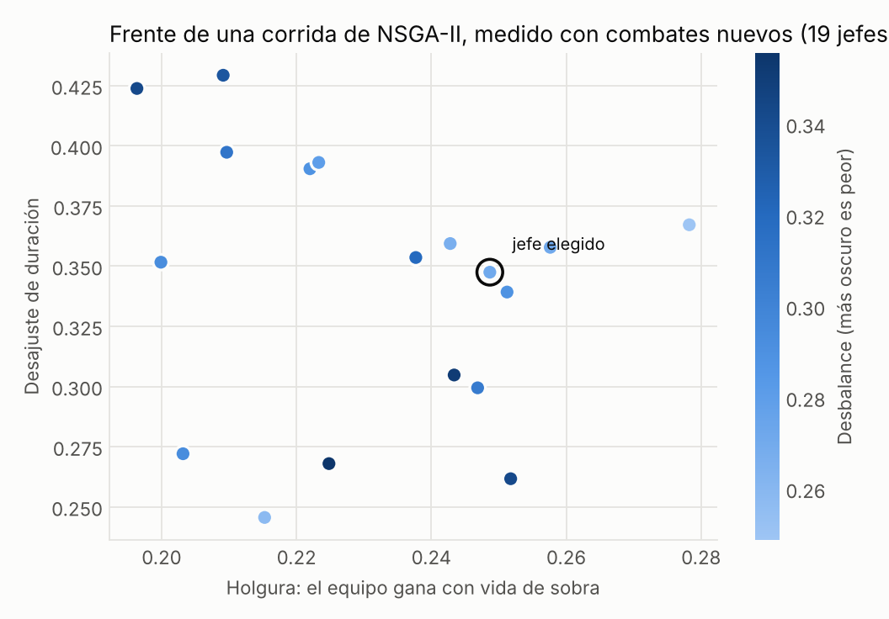

# Jefe RPG evolutivo

Dos algoritmos evolutivos que diseñan jefes para un RPG por turnos: un algoritmo genético binario de un solo objetivo y NSGA-II, su versión multiobjetivo. Un motor de combate enfrenta a cada jefe contra los 15 equipos que puede armar el jugador, y los algoritmos buscan el jefe que da el combate más parejo: que el equipo gane entre 40% y 60% de las veces, en unas 10 rondas, y termine con poca vida.

Proyecto final de Cómputo Evolutivo, CETYS Universidad.

## Requisitos

- Python 3.10 o más reciente
- pytest y matplotlib

## Instalación

Windows (PowerShell):

```powershell
git clone <url-del-repositorio>
cd <carpeta-del-repositorio>
python -m venv .venv
.\.venv\Scripts\Activate.ps1
pip install -r requirements.txt
```

macOS o Linux:

```bash
git clone <url-del-repositorio>
cd <carpeta-del-repositorio>
python3 -m venv .venv
source .venv/bin/activate
pip install -r requirements.txt
```

## Cómo probarlo

Los comandos van en la terminal. Todo usa semillas fijas, así que los números deben coincidir con los de esta tabla.

| Paso | Comando | Qué debe salir | Tiempo |
|---|---|---|---|
| 1 | `python -m pytest -q` | 64 passed | 5 s |
| 2 | `python genetico.py` | Termina con F = 0.7491 | 30 s |
| 3 | `python nsga2.py` | Un frente de 9 jefes con hipervolumen 0.2734 | 30 s |
| 4 | `python narrar.py resumen` | Un combate, una línea por ronda | 1 s |
| 5 | `python jugar.py` | Eliges un jefe del frente y juegas contra él | lo que dure la partida |
| 6 | `python comparar.py corto` | resultados_corto.csv y comparacion_corto.png | 12 min |
| 7 | `python comparar.py` | resultados_largo.csv, comparacion_largo.png y frente.png | 40 min |

Los tiempos son de una máquina con 2 núcleos; `comparar.py` reparte las corridas entre todos los que haya.

Si el paso 1 falla, no sigas: algo está roto.

## El juego

Cuatro héroes contra un jefe, por turnos. El jugador arma su equipo con 4 de las 6 clases.

Todos los personajes tienen seis atributos: vida, ataque físico, defensa física, ataque mágico, defensa mágica y velocidad. Cada clase reparte 600 puntos entre ellos; el maná va aparte.

| Clase | Perfil | Conjuros |
|---|---|---|
| Guerrero | Equilibrado en todo | Guardia de acero (sube su defensa dos turnos) y dos tajos mágicos de elemento aleatorio |
| Tanque | Mucha vida y defensa, poco ataque y velocidad | Muralla (sube su defensa dos turnos) y Bloqueo total (anula un ataque) |
| Mago | Mucho ataque mágico, poca vida y defensa | 3 conjuros de una lista de 16 y 1 de una lista de 8 poderosos, sin repetir elemento |
| Clérigo | Equilibrado, su magia cura | Curación menor, mayor y en grupo |
| Pícaro | Ataque físico y velocidad altos, defensa baja | Dos ataques que se adelantan a todos en la ronda |
| Berserker | Mucho ataque físico, poca defensa mágica | Furia (sube su ataque dos turnos) y Furia desatada (sube su ataque y pega) |

Reglas principales:

- **Ataques físicos y mágicos.** Los físicos usan ataque y defensa físicos, varían entre x0.80 y x1.20 y pueden salir críticos (x1.60). Guerrero y Pícaro tienen más probabilidad de crítico y su mínimo es x0.90. Los mágicos usan los atributos mágicos, varían entre x0.85 y x1.00, no tienen crítico y llevan un elemento.
- **Elementos y objetos.** Hay 8 elementos: fuego, agua, viento, tierra, planta, rayo, luz y oscuridad. Un elemento es solo una etiqueta: lo que importa son los objetos equipados, que dan bonos como +20% de ataque de fuego o -25% de defensa contra agua. Hay 16 objetos, dos por elemento.
- **Velocidad.** Decide el orden de los turnos. Quien es más rápido que su atacante puede esquivar: la probabilidad crece con la diferencia de velocidad, de 1% a 15%.
- **Maná.** Todos los conjuros cuestan maná y el ataque básico es gratis. Solo Mago y Clérigo lo recuperan poco a poco.
- **Bloquear.** Cualquiera puede gastar su turno en bloquear y recibir la mitad del daño hasta su siguiente turno.
- **Pociones.** El equipo comparte dos pociones chicas y una grande de vida, y lo mismo de maná. No hay forma de revivir.

El jefe reparte 1500 puntos entre sus seis atributos y lleva un objeto. No gasta maná y sus críticos son menos probables.

- **Cola de ataques.** Tiene 8 ataques tomados de un banco de 32, en fila. Solo puede elegir entre los primeros 4; el que usa pasa al final de la fila.
- **Ataques de área y de carga.** Los de área pegan menos a cada héroe pero suman más daño. Cuatro ataques del banco gastan un turno en cargar y pegan muy fuerte al siguiente, lo que le da tiempo al equipo de bloquear.
- **Fase 2.** Al bajar de la mitad de su vida cambia de objeto, dos ataques de su cola se reemplazan por otros y sus atributos se mueven un poco hacia arriba o hacia abajo.
- **Predisposición.** Elige a quién atacar con una probabilidad por clase que viene en sus genes.
- **Bloqueo.** También puede gastar un turno en bloquear.

Al equipo lo controla un jugador automático durante la evaluación (`heuristico.py`). En `jugar.py` lo controlas tú, con las mismas reglas, y puedes escoger entre el jefe que eligió el algoritmo y el mejor del frente en cada objetivo.

## Archivos

| Archivo | Qué hace |
|---|---|
| `motor.py` | Fachada: junta los módulos de abajo para que los scripts usen `import motor` |
| `reglas.py` | Elementos, objetos y fórmulas de daño |
| `clases.py` | Las seis clases, sus conjuros y los 15 equipos |
| `jefe.py` | Puntos del jefe, banco de 32 ataques, fase 2 y reparación del cromosoma |
| `heuristico.py` | Jugador automático |
| `combate.py` | Simulación de un combate |
| `aptitud.py` | Función objetivo F y función de costo C = 1 − F |
| `genetico.py` | Algoritmo genético binario (rango, costo o torneo; cruce de un punto; mutación; elitismo) y búsqueda aleatoria |
| `nsga2.py` | NSGA-II: ordenamiento no dominado, distancia de crowding, torneo binario, restricción e hipervolumen |
| `comparar.py` | Experimento final: los dos algoritmos, con semillas fijas y rotativas, contra la búsqueda aleatoria |
| `narrar.py` | Cuenta un combate turno por turno |
| `jugar.py` | Modo interactivo en la terminal, contra un jefe del frente |
| `calibrar.py` | Histograma de la tasa de victoria de jefes aleatorios |
| `test_motor.py`, `test_genetico.py`, `test_nsga2.py` | Pruebas con los valores esperados calculados a mano |
| `frente.json`, `mejor_jefe.json` | El frente de una corrida de NSGA-II y el jefe elegido de ese frente; si los borras, se vuelven a crear |

## Cromosoma

134 bits:

| Tramo | Bits | Qué guarda |
|---|---|---|
| 6 atributos | 6 × 4 | Proporción del presupuesto de 1500 puntos |
| 2 objetos | 2 × 4 | Objeto de la fase 1 y de la fase 2 |
| 8 ataques | 8 × 5 | La cola inicial, con índices del banco de 32 |
| 8 pesos | 8 × 2 | Qué tanto prefiere cada ataque de la cola |
| 2 cambios de fase 2 | 2 × (3 + 5) | Qué posición de la cola cambia y por cuál ataque |
| 5 ajustes de fase 2 | 5 × 2 | Cómo se mueve cada atributo, menos la vida |
| 6 predisposiciones | 6 × 3 | Preferencia por atacar a cada clase |
| Bloqueo | 2 | Probabilidad de bloquear en un turno: 0, 5, 10 o 15% |

Una función de reparación hace válida cualquier cadena de bits: los puntos suman 1500, no hay ataques repetidos en la cola y los ataques que entran en la fase 2 no repiten a los que ya están.

## Función objetivo y función de costo

```
F = f_win × (0.5·margen + 0.25·duración + 0.25·variedad)
C = 1 − F        (el algoritmo minimiza C)
```

- `f_win = 1 − 2d`, con d = distancia de la tasa de victoria del equipo a la banda 40–60%
- margen: qué tan cerca de 20% de vida termina el equipo cuando gana
- duración: qué tan cerca de 10 rondas dura el combate
- variedad: entropía de Shannon del uso de las habilidades del jefe, entre su máximo

Cada jefe pelea 10 combates contra cada uno de los 15 equipos (150 en total) y su F es el promedio de los 15.

## NSGA-II

F junta tres medidas en un solo número con pesos que escogimos a mano. NSGA-II trabaja con las medidas por separado y entrega un frente de Pareto: un conjunto de jefes donde ninguno es mejor que otro en todo.

Objetivos, los tres a minimizar:

| Objetivo | Qué mide |
|---|---|
| Desbalance | Qué tan lejos queda la tasa de victoria de cada equipo de 50% |
| Holgura | El equipo gana con mucha más vida que el 20% ideal (1 − margen) |
| Desajuste de duración | Los combates duran mucho más o mucho menos de 10 rondas (1 − duración) |

La variedad no entra como objetivo. Desde que el jefe ataca con una cola, casi cualquier jefe la tiene arriba de 0.9, y como objetivo solo llenaba el frente de jefes malos que ganaban una centésima de variedad.

Restricción: un jefe solo es aceptable si, en promedio, la tasa de victoria de los equipos queda a no más de 0.10 de la banda 40–60%. Se usa dominancia con restricciones: el que cumple le gana al que no, y entre dos que no cumplen gana el que viola menos. Sin la restricción el frente se llenaba de jefes con la duración perfecta que ningún equipo podía vencer.

El cromosoma, el cruce de un punto y la mutación son los mismos del algoritmo genético. Cambia la selección: ordenamiento no dominado, distancia de crowding y torneo binario, y los sobrevivientes se escogen entre padres e hijos juntos.

**Semillas rotativas.** Para atacar el sobreajuste, cada generación pelea combates distintos y los padres se vuelven a evaluar junto con sus hijos. Cuesta el doble de evaluaciones por generación. El algoritmo genético de un solo objetivo también lo puede usar, con `rotarSemillas=True`.

## Resultados

10 corridas por método. Al final de cada corrida, el jefe que entrega el método se vuelve a medir con 30 combates por equipo que ningún método vio durante la búsqueda. Esa es la columna que cuenta.

Presupuesto largo, 1830 evaluaciones (60 generaciones de 30 jefes):

| Método | F en la búsqueda | F con combates nuevos | t contra aleatoria | Corridas arriba de la media aleatoria |
|---|---|---|---|---|
| AG, semillas rotativas | 0.726 | 0.698 ± 0.025 | 3.56 | 10 de 10 |
| NSGA-II, semillas rotativas | | 0.689 ± 0.033 | 2.79 | 9 de 10 |
| NSGA-II, semillas fijas | | 0.675 ± 0.029 | 2.02 | 9 de 10 |
| AG, semillas fijas | 0.781 | 0.653 ± 0.035 | 0.67 | 8 de 10 |
| Búsqueda aleatoria | 0.710 | 0.642 ± 0.044 | | |


Presupuesto corto, 630 evaluaciones (el del avance 2):

| Método | F en la búsqueda | F con combates nuevos | t contra aleatoria |
|---|---|---|---|
| AG, semillas rotativas | 0.713 | 0.678 ± 0.031 | 1.47 |
| NSGA-II, semillas rotativas | | 0.661 ± 0.046 | 0.22 |
| Búsqueda aleatoria | 0.698 | 0.657 ± 0.031 | |
| NSGA-II, semillas fijas | | 0.643 ± 0.038 | −0.95 |
| AG, semillas fijas | 0.751 | 0.641 ± 0.032 | −1.12 |

Lo que dicen los números:

- **Las semillas rotativas son lo que más ayuda.** Con semillas fijas el algoritmo genético llega a F = 0.78 durante la búsqueda y se cae a 0.65 con combates nuevos: aprende los 10 combates con los que evalúa. Rotando las semillas la caída es de 0.73 a 0.70.
- **Con 630 evaluaciones ningún método se separa de la búsqueda aleatoria.** Con el cromosoma de 134 bits ese presupuesto ya no alcanza. Con 1830 sí: los dos algoritmos con semillas rotativas le ganan con t = 3.56 y t = 2.79.
- **La búsqueda aleatoria no mejora con más evaluaciones** (0.657 con 630, 0.642 con 1830). Entre más jefes prueba con los mismos combates, más probable es que se quede con uno que solo tuvo suerte.
- **NSGA-II queda a la par del algoritmo genético en F** (0.689 contra 0.698; la diferencia está dentro de una desviación estándar) y además entrega un frente de jefes para escoger, no uno solo.



Limitaciones:

- F con combates nuevos se queda cerca de 0.70 para todos. Con 10 combates por equipo la tasa de victoria de cada equipo se mide con mucho ruido, y ser parejo contra los 15 equipos a la vez es difícil.
- Los objetivos del frente se miden con ese mismo ruido: al volver a medirlos con combates nuevos algunos jefes del frente quedan dominados por otros.
- 10 corridas por método es poco para afirmar diferencias chicas, como la que hay entre NSGA-II y el algoritmo genético con semillas rotativas.
- El jugador automático no planea a futuro. Un jefe parejo contra él no tiene por qué serlo contra una persona.

## Cómo se llegó aquí

El proyecto pasó del juego del avance 2 al actual en cinco etapas. Cada una deja el repositorio funcionando, con sus pruebas pasando y sus propios resultados.

| Etapa | Qué cambió | Cromosoma | Pruebas | F del AG por rango, 630 evaluaciones (búsqueda / combates nuevos) |
|---|---|---|---|---|
| Avance 2 | Punto de partida: 4 héroes, 4 elementos en ciclo, jefe de 4 habilidades | 44 bits | 33 | 0.886 / 0.687 |
| 1 | Se separa `motor.py` en módulos, sin cambiar ninguna regla | 44 bits | 33 | 0.886 / 0.687 |
| 2 | Lado de los héroes: 6 atributos, 6 clases con conjuros y maná, 8 elementos con objetos, físico y mágico, críticos, esquive, bloqueo, pociones de maná, 15 equipos | 56 bits | 43 | 0.586 / 0.471 |
| 3 | Lado del jefe: cola de 8 ataques de un banco de 32, ataques de carga, fase 2 completa, predisposición por clase | 134 bits | 50 | 0.751 / 0.606 |
| 4 | NSGA-II con restricción, hipervolumen y semillas rotativas | 134 bits | 63 | |
| 5 | Experimento final con validación y dos presupuestos; el juego usa el frente | 134 bits | 64 | 0.751 / 0.641 (ver tablas de arriba) |

Dos cosas cambiaron respecto al avance 2 además de las reglas. El jefe ya no se califica con su peor equipo sino con el promedio de los 15, porque con tantos equipos el peor castigaba a jefes buenos por una sola combinación rara. Y la validación de la etapa 5 usa 30 combates por equipo en lugar de 10, por eso su número con combates nuevos no es idéntico al de la etapa 3.
